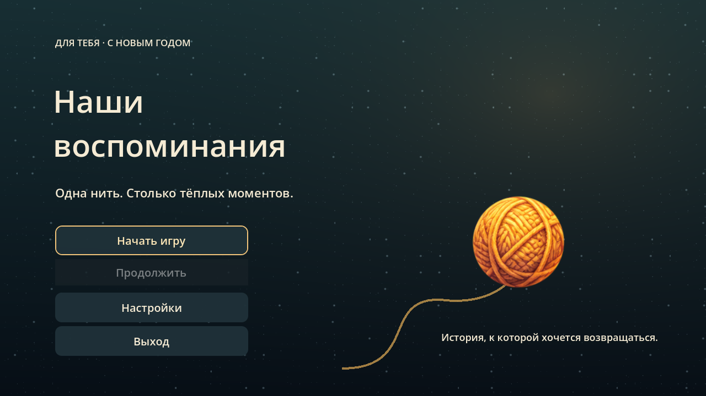
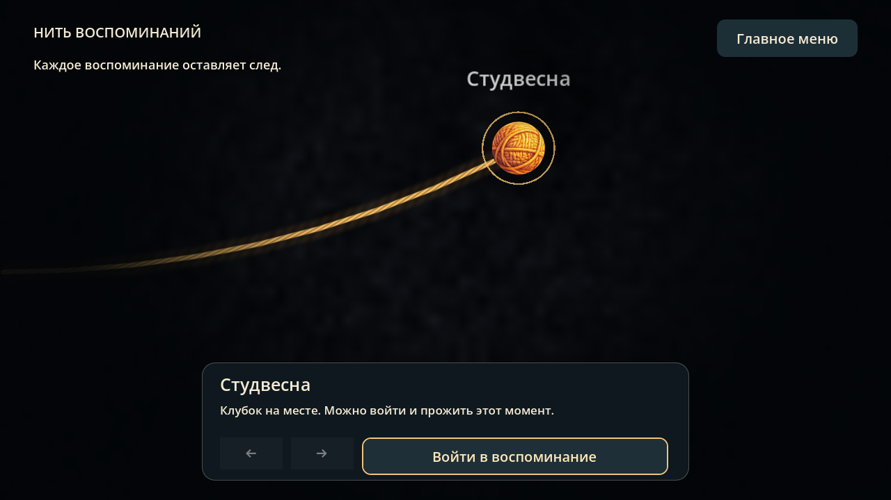
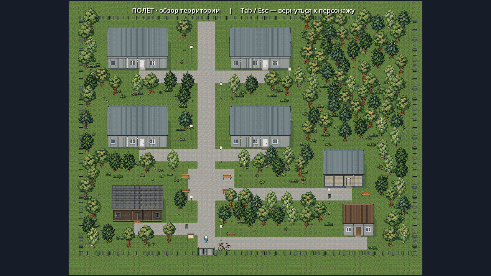
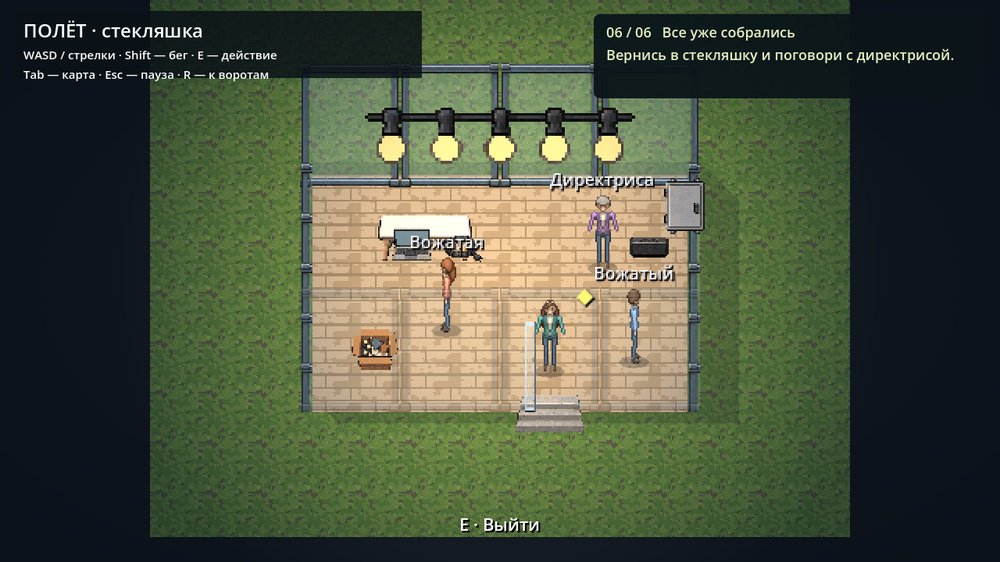
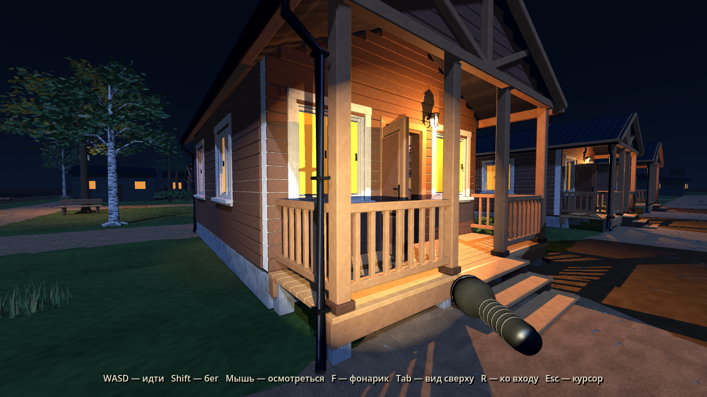
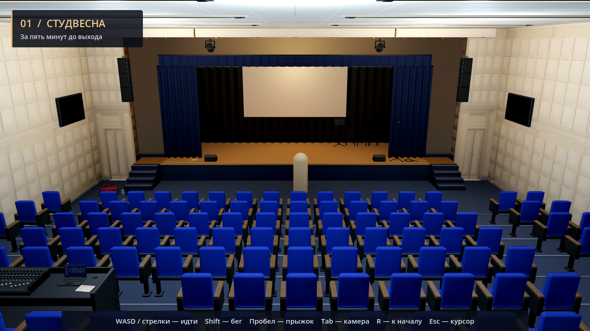

# Воспоминания — проект Godot

**F5** открывает меню **«Наши воспоминания»**: **Начать игру · Продолжить · Настройки · Выход**. Начало и продолжение ведут на карту с клубком; новой игре предшествует подтверждение, если уже есть прохождение. **F6** позволяет отдельно запускать уровни из `scenes/levels/`.



Клубок сам катится по нити, камера следует за ним. После остановки нажмите **«Войти в воспоминание»**. После завершения главы вернитесь **«Дальше по нити»** — откроется следующий участок. Уже открытые точки можно посещать повторно стрелками на карте. Положение клубка сохраняется даже при выходе посреди движения.



Сейчас подключены зал, «Полёт» и Веневитино. В «Студвесне» теперь можно пройти подготовку, репетицию, массовый танец и общий финал «ФКН!». Глава завершается после финала, подготовка сохраняется при выходе. После Веневитино клубок приходит к зарезервированному корпорату. Корпорат и день рождения ещё создаются; финал всей истории преждевременно не запускается. После всех пяти глав предусмотрено отдаление камеры с раскрытием LOVE и посвящением к подарку.

[Карта, переходы, сохранения и предпросмотр финала](docs/JOURNEY.md)

## Полёт — второй уровень

Пиксельная 2D-территория с четырьмя современными корпусами, старой деревянной общагой, стекляшкой, закрытой админкой и воротами. В каждый корпус можно войти по E, пройти коридор и попасть в комнату. Общага и стекляшка тоже доступны. Планировка проектная: точной схемы реального лагеря пока нет.



Теперь можно пройти историю последнего дня: **уборка корпуса → поддержка ребёнка → сдача рации → подготовка стекляшки → поездка на велосипеде → прощальный вечер**. Героиня, ребёнок, директриса и два разных вожатых представлены анимированными пиксельными персонажами, отрендеренными из моделей Blender. В общаге можно выбрать один из трёх цветов одежды.

**WASD / стрелки** — ходить, **Shift** — бежать, **E** — двери и разговоры; для уборки и гирлянды удерживать E. **Tab** — карта с текущей целью (в том числе из помещений), **Esc** — пауза / закрыть карту или мини-игру, **R** — к воротам. Подсказка справа показывает текущее дело. Прогресс автоматически сохраняется на диск: повторный запуск продолжает смену с безопасной точки у ворот. В паузе доступны громкость, движение листвы, полноэкранный режим и подтверждённый запуск новой смены.

В щитке нужно включить три линии, при настройке звука — трижды поймать зелёную зону кнопкой **Space / Enter**. В поездке **W / S / ↑ / ↓** позволяют объезжать ямы, **Shift** ускоряет велосипед. Столкновение только замедляет. После финала можно гулять по лагерю.



[Персонажи и модели Blender](art/polet_cast/README.md) · [Диалог](docs/polet-final-dialogue.png) · [Велосипед](docs/polet-final-bicycle.png) · [Карта](docs/polet-final-map.png) · [Финал](docs/polet-final-ending.png)

Вся геометрия, растительность, коллизии, мебель и переходы сохранены в редактируемых сценах. Скрипты отвечают за движение, переходы, задания, диалоги и правила мини-игр; объекты и интерфейс не создаются при запуске.

[Описание сцен и проверки](docs/POLET.md) · [Корпус](docs/polet-level-cabins.png) · [Комната](docs/polet-level-room.png) · [Общага](docs/polet-level-dorm.png) · [Стекляшка](docs/polet-level-glass.png)

## Веневитино — третий уровень



[План территории](docs/venevitino-plan.png) · [Навес](docs/venevitino-canopy.png) · [Интерьер](docs/venevitino-interior.png)

На территории 41 домик с тремя вариантами интерьера, река и причал слева, центральный въезд снизу, навесы, спортивные площадки и упрощённые служебные здания. Расстановка опирается на присланную схему; названия этапов посвящения отсутствуют. Всё окружение, коллизии и свет сохранены в сценах. Двери домиков стоят открытыми.

Вокруг домиков и дорожек добавлены рощи, кустарник, плотная трава и цветы, вдоль воды — камыш. Дополнительная растительность собрана в `scenes/venevitino/foliage/` сохранёнными группами MultiMesh с ограничением дальности; генерации при запуске нет.

Главная механика Веневитино — **найти и собрать 20 бутылок**. Они лежат в домиках, кустах, рюкзаках и открытых местах. Подойдите, наведите взгляд и нажмите **E**: появится сообщение о находке и обновится счётчик. После последней бутылки поиск завершается; прогулку можно продолжить. Найденные бутылки сохраняются на диск и восстанавливаются после выхода на карту и перезапуска игры; прогулка начинается у въезда.

По территории ходят **три организатора** с фонариками. Они постепенно замечают игрока перед собой, преследуют и теряют след за преградами. При встрече отправляют ко входу, сохраняя собранные бутылки и давая 10 секунд без обнаружения. После завершения поиска перестают задерживать игрока. Кусты пока не служат укрытием.

Управление: **WASD**, мышь, **Shift** — бег, **Пробел** — прыжок, **E** — подобрать бутылку, **F** — фонарик, **Tab** — обзор территории / первое лицо, **R** — ко въезду, **Esc** — пауза и возврат на карту. Повторный Esc продолжает игру и возвращает управление мышью. В обзоре повышается видимость для чтения плана; при возвращении восстанавливается ночное освещение.

[Устройство сцен, ограничения и проверки Веневитино](docs/VENEVITINO.md).

[Подбор бутылок: управление, редактирование и проверки](docs/BOTTLE_HUNT.md).

[Организаторы: поведение, маршруты и проверки](docs/ORGANIZERS.md).

## Студвесна — первый уровень

Вещи в левой кулисе → три отметки на сцене → костюм и грим → выход → массовый танец → общий финал. Марина находится в левой кулисе, Глеб — в правой; разговоры необязательны. **E** — действие у золотой отметки. На сцену можно подняться по боковым ступеням и пройти между шторой и монитором. В танце **A / ←** и **D / →** дают отклик без проигрыша; кнопка «Просто смотреть» позволяет обойтись без нажатий. **Esc** ставит на паузу и музыку, и номер.

Персонажи — рисованные фигурки в 3D-окружении. Музыка из `tanec_vesna.MP4`; хореография стилизована, диалоги художественные, «ФКН!» показано субтитром с синтезированными аплодисментами. Подробнее: [STUDVESNA.md](docs/STUDVESNA.md).

Уровень **Godot 4.6**, собранный по `../concept.png` из пользовательского набора Studvesna. Модели, необходимые для запуска, сохранены в `assets/models/`.



[Вид из прохода](docs/level01-detail.png) · [До обновления света](docs/level01-before-lighting.png)

## Запуск

1. В менеджере проектов Godot нажмите **Import** и выберите `godot/project.godot`.
2. Дождитесь первого импорта моделей и текстур.
3. Нажмите **F5**, чтобы открыть меню и начать путь по нити. Для отдельного запуска откройте нужную сцену в `scenes/levels/` и нажмите **F6**.

Из терминала, находясь в папке `godot`:

```bash
godot --editor --path .
godot --path .
```

Используется рендерер Compatibility. Для импорта готовых GLB устанавливать Blender не требуется. Модели с текстурами уже находятся внутри проекта; подключение к Интернету для запуска не нужно.

## Свет и материалы

Сцена освещена тёплыми сценическими приборами, зрительный зал — более прохладным потолочным светом. Статичное освещение рассчитано через LightmapGI; локальный ReflectionProbe добавляет отражения на дереве и металле. Кресла получили общий материал ткани с рельефом и мягким бликом по краям, настил — карты древесины, шероховатости и тонкий лаковый слой. Цветокоррекция и свечение ламп настроены в ресурсе окружения.

Готовое запекание хранится в `assets/lighting`. При изменении геометрии или расположения света его нужно обновить в редакторе. [Параметры и инструкция повторного запекания](docs/LIGHTING.md).

## Атмосфера сцены

Боковые кулисы слегка колышутся: верх закреплён, нижняя часть смещается примерно на два сантиметра. Два полотна двигаются с разной скоростью и фазой. Над сценой медленно дрейфуют редкие пылинки с мягким появлением и исчезновением.

Движение задаёт шейдер ткани, пыль — два экземпляра отдельной сцены CPUParticles3D. Всё настраивается в инспекторе Godot. [Ресурсы и параметры эффектов](docs/ATMOSPHERE.md).

[Близкий ракурс сцены с эффектами](docs/level01-atmosphere.png). На статичном снимке движение не передаётся: для просмотра откройте игру, нажмите Tab и подойдите к кулисам.

## Управление

| Клавиша | Действие |
| --- | --- |
| WASD / стрелки | Ходить |
| Shift | Бежать |
| Пробел | Прыгнуть |
| E | Войти в кулисы / вернуться в зал возле двери |
| Tab | Общий ракурс / вид от первого лица |
| Мышь | Осматриваться от первого лица |
| Esc | Пауза / продолжить |
| ЛКМ | Вернуть управление мышью от первого лица |
| R | Вернуться ко входу в текущую локацию |

Движение следует направлению текущей камеры: в общем ракурсе зала W ведёт к сцене, в кулисах — в глубину их обзорного ракурса. После падения за пределы уровня игрок возвращается ко входу в текущую локацию.

## Комнаты кулис

Через боковые двери по E доступны две комнаты. Слева зеркала со столиками стоят у дальней стены, крючки и табуретки — у ближней; дверь находится посередине правой стены. В правой комнате зеркала, столики и стулья расположены слева, а у ближней стены справа от двери стоит розовый рояль. Расстановка учитывает описание пользователя.

[Левая кулиса](docs/backstage-left.png) · [Правая кулиса](docs/backstage-right.png) · [Розовый рояль](docs/backstage-piano.png)

Режим камеры сохраняется при переходах; Tab выбирает обзор текущей комнаты. Зеркала пока декоративные, рояль пока не имеет музыкального взаимодействия. [Планировка, ресурсы и проверки](docs/BACKSTAGE.md).

## Что собрано

- Сцена с деревянным настилом, синим фасадом, двумя лестницами и площадками.
- Синие боковые кулисы, чёрный задник и экран.
- Ступенчатый зрительный зал с боковыми проходами и местом звукорежиссёра.
- Кремовые акустические стены, двери, потолочные панели и светильники.
- Микрофон, мониторы, настенные дисплеи, колонки, складные стулья и пюпитр.
- Сумка, наколенники, бутылка воды, программа выступления.
- Капсула игрока с коллизией, две камеры и подсказки управления.

Это уровень для исследования и дальнейшей разработки. Зал связан с двумя комнатами кулис. Диалоги, сбор предметов и ритм-босс пока не реализованы.

## Редактирование

Всё окружение, свет, камеры и коллизии сохранены в `.tscn` и видны в редакторе **до запуска игры**. Скрипты `scripts/capsule_player.gd` и `scripts/room_portal.gd` отвечают за управление, камеры и переходы. Процедурной генерации уровня скриптами нет.

| Сцена | Назначение |
| --- | --- |
| `scenes/levels/auditorium.tscn` | Основная расстановка, реквизит, освещение и камеры |
| `scenes/architecture/hall_shell.tscn` | Пол, стены, потолок и декоративные дверные фасады |
| `scenes/architecture/stage.tscn` | Сцена, лестницы, кулисы и экран |
| `scenes/architecture/seating.tscn` | Террасы, ряды и проходы зрительного зала |
| `scenes/architecture/seat_row.tscn` | Один повторяемый ряд кресел |
| `scenes/props/*.tscn` | Готовые модели с дополнительными коллизиями |
| `scenes/effects/stage_dust.tscn` | Пыль над сценой |
| `scenes/rooms/backstage_left.tscn` | Левая кулиса с зеркалами и крючками |
| `scenes/rooms/backstage_right.tscn` | Правая кулиса с розовым роялем |
| `scenes/interactions/room_portal.tscn` | Переход по E и подсказка у двери |
| `scenes/player/capsule_player.tscn` | Капсула, физическое тело, маркер направления и камера |

Откройте нужную вложенную сцену, чтобы поменять её устройство. Передвигать экземпляры можно в основной сцене. Изменение `auditorium_chair.tscn` применяется ко всем креслам.

В сцене кресла для задней стороны спинки задан синий материал из набора, чтобы ряды соответствовали референсу. Исходный GLB не изменён. Общая камера вынесена за заднюю стену для широкого ракурса: стена находится на слое видимости 2, исключённом только у этой камеры. От первого лица стена видна; её коллизия работает в обоих режимах.

Для лестниц и ступенчатых проходов вручную заданы гладкие наклонные коллизии: капсула поднимается без прыжков, при этом видимая геометрия остаётся ступенчатой. Коллизии кресел, стен, стола и крупных предметов также заданы явно.

## Исходные модели

В `assets/models` находятся копии 33 самостоятельных GLB из набора Studvesna. Их материалы и текстуры встроены. Исходная папка набора доступна в истории репозитория до загрузки Веневитино; для запуска игры она не требуется.

Модели используются как вложенные сцены, поэтому их можно заменять без переписывания управления. Размеры зала согласованы с моделями, но не являются обмерами здания. Архитектурные модули местами масштабированы, чтобы собрать цельное помещение.

Редактор создаёт локальный кэш `.godot/`; он исключён из Git. Файлы `.import` и `.uid` сохраняют параметры импорта и идентификаторы ресурсов.

## Проверка

Проверено в Godot 4.6.3: после обновления света выполнены чистый импорт копии проекта без `.godot`, загрузка главной сцены и визуальная проверка обоих ракурсов. Скриншоты сняты из работающего проекта.

При создании уровня прошла 21 проверка управления и столкновений: оба боковых прохода, подъём на сцену по обеим лестницам без прыжка, стены, кресла, прыжок, переключение камер и возврат к начальной точке. В обновлении света управление и коллизии не менялись.

После добавления кулис эти 21 проверка выполнены повторно. Также прошли 25 проверок комнат и переходов из `tests/backstage_smoke.gd`; снимки новых комнат получены в графическом режиме Compatibility.
