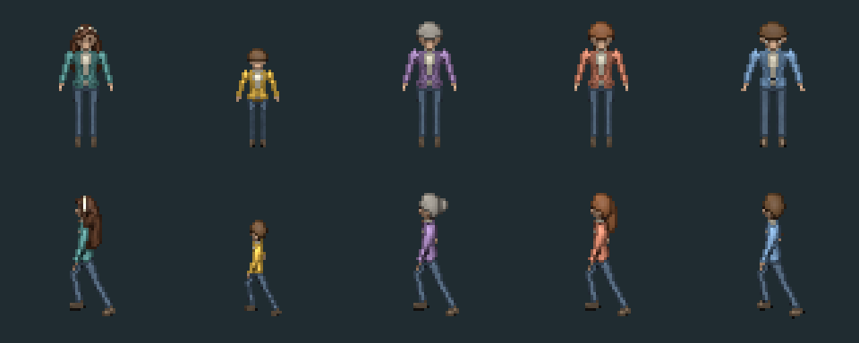

# Персонажи «Полёта»

Пять моделей для пиксельного второго уровня. Основа — ранее созданная по пользовательскому референсу героиня из `art/heroine/blender/heroine.blend`; её исходник не изменён. В новой сцене сделаны собственные материалы, причёски, пропорции и анимации для лагеря.



## Файлы

- `polet_cast.blend` — все пять редактируемых моделей в коллекциях `heroine`, `child`, `director`, `counselor`, `counselor_male`, камера, материалы, скелеты и действия.
- `frames/` — 280 прозрачных кадров Blender, без дорисованных подмен. Это исходники для сборки атласов; папка `art/` не импортируется Godot.
- `../../assets/polet/characters/` — пять атласов PNG, соответствующие SpriteFrames TRES и портреты. Игровой размер кадра 64×64, фильтрация Nearest. У каждого персонажа 4 направления idle (4 кадра) и walk (8 кадров). У героини также 4 направления work (8 кадров) и ride (8 кадров).
- `build_cast.py`, `pack_cast.py`, `render_portraits.py` — инструменты офлайн-производства. `author_audio.py` — оригинальные музыкальные и шумовые ассеты. В игре ничего из этих скриптов не выполняется.

## Образы

Героиня сохраняет каштановые волосы и светлый ободок. Для лагеря выбраны светлый верх, бирюзовая куртка и синие брюки; в общаге куртку можно заменить терракотовой или светлой. Ребёнок заметно ниже взрослых, в жёлтой куртке и с короткими волосами. Директриса — седая, с собранными волосами, в фиолетовом. Рыжая вожатая — в терракотовом, вожатый с короткой стрижкой — в синем. NPC — авторские стилизованные образы, не портреты реальных знакомых.

Модели предназначены для согласованного 2D-уровня: в сцене Godot используются готовые рендеры, а не 3D-персонажи поверх тайлов. Камера Blender ортографическая, фон прозрачный. Входящие в модель материалы хранятся в .blend. Работа в Godot не требует установки Blender.

## Повторное создание ассетов

Из корня репозитория:

```sh
blender -b -t 4 --python godot/art/polet_cast/build_cast.py
python godot/art/polet_cast/pack_cast.py
blender -b -t 4 --python godot/art/polet_cast/render_portraits.py
python godot/art/polet_cast/author_audio.py
```

Сборка перезаписывает эти созданные ассеты; для ручных правок открывать .blend, а затем рендерить нужные кадры. Оригинальная модель героини для других уровней остаётся отдельно. Уровень использует отдельные сцены персонажей и сохранённые SpriteFrames, а скрипты только выбирают направление и анимацию по движению.
