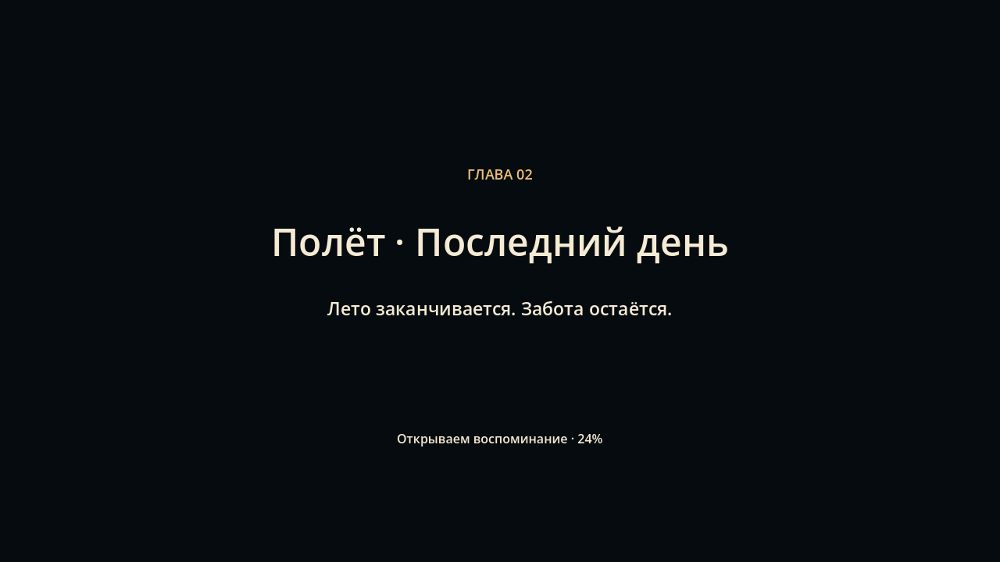

# Альбом воспоминаний

Точка входа F5 — `scenes/menu/main_menu.tscn`. Три главы открыты сразу: выбор главы не стирает прохождение. «Начать путешествие» открывает зал; после первого посещения кнопка становится «Продолжить путешествие» и открывает последнюю главу. Существующее сохранение «Полёта» распознаётся при первом запуске обновлённого проекта.

## Переходы

- **Зал → Полёт**: Esc → «Дальше». В зале пока нет завершённого сюжетного задания, поэтому это ручной переход, а не награда за выдуманное прохождение.
- **Полёт → Веневитино**: «Дальше · Веневитино» на карточке после прощального вечера. До финала из паузы можно вернуться в альбом и выбрать любую главу.
- **Веневитино → альбом**: Esc → «В альбом». После последней бутылки появляется итоговая карточка; можно продолжить гулять или вернуться в меню. Будущие главы здесь пока не подключены.

Сначала сохраняется прогресс, затем идёт затемнение, название/короткая фраза главы и фоновая загрузка PackedScene с индикатором. Мир заморожен до конца появления. Повторное нажатие не запускает вторую загрузку. Ошибка записи отменяет переход и оставляет текущую сцену доступной; ошибка загрузки также возвращает к ней. Esc в 3D замораживает в том числе организаторов и освобождает курсор; продолжение возвращает прежний режим мыши. В «Полёте» сохраняется собственная логика Esc для диалогов и мини-игр.

## Сохранения и настройки

- `user://journey_v1.cfg`: последняя глава, пути найденных бутылок, громкость, полноэкранный режим, анимация снега в меню. Запись через временный файл и резервную копию `.bak`.
- `user://polet_last_day_v1.json`: существующий независимый файл заданий «Полёта», не удаляется. Уровень восстанавливается у ворот с выполненными заданиями, одеждой и частичными головоломками.
- Веневитино сохраняется при каждом подборе. Счётчик/видимость бутылок восстанавливаются без повторной награды и звука. Позиции организаторов и игрока сбрасываются к начальным, а не сохраняются посреди погони.
- Зал открывается с начальной точки. Состояния будущих заданий зала пока нет.
- Смена главы/кнопка начала путешествия **не сбрасывает** прогресс других глав. Новую смену «Полёта» можно начать через его существующее подтверждение в паузе. Отдельного сброса поиска бутылок пока нет.

`user://` определяется каталогом приложения Godot, например Linux: `$XDG_DATA_HOME/godot/app_userdata/Воспоминания · Полёт`. В `project.godot` сохранено прежнее `config/name`, чтобы не менять путь сохранений ни на одной платформе; заголовок окна меняет Journey.

## Сцены и оформление

- `scenes/menu/main_menu.tscn`: фон, карточка с фотографией, три кнопки глав, продолжение и настройки.
- `scenes/menu/journey.tscn`: autoload CanvasLayer 100, пауза, настройки, затемнение, музыка. Все элементы сохранены в сцене; генерации интерфейса или мира при запуске нет.
- `resources/menu/theme.tres`: тёмный бирюзовый фон, кремовый текст, золотая рамка фокуса.
- `shaders/menu/winter.gdshader`: небольшой снег; его движение отключается настройкой.
- `assets/menu/*.png`: настоящие кадры игровых сцен без HUD. Это статичные карточки; три уровня не загружаются одновременно ради меню.
- Музыка меню — собственная композиция `assets/polet/audio/last_evening.wav`, с плавным затиханием перед главой.

Верстка меню/общих модальных окон рассчитана на 1280×720 и масштабируется пропорционально, с центровкой при другом соотношении сторон. Управление мышью или Tab/стрелками и Enter; Esc закрывает настройки/паузу. Полноэкранный режим и громкость доступны в меню.

## Проверка

```sh
godot --headless --path godot --editor --import
godot --headless --path godot --quit-after 2
XDG_DATA_HOME=/tmp/journey-smoke/data XDG_CONFIG_HOME=/tmp/journey-smoke/config XDG_CACHE_HOME=/tmp/journey-smoke/cache godot --headless --path godot --fixed-fps 60 --script res://tests/journey_smoke.gd
```

Сквозной тест требует изолированный каталог и проверяет настоящие переходы между всеми сценами, блокировку повторного перехода, паузу, настройки, оба вида сохранения, финальную карточку и отказ записи. Реальный захват мыши нужно проверять с графическим дисплеем: headless-драйвер его не реализует. Дополнительно запускаются существующие проверки «Полёта» и поиска бутылок.



Итог проверки: **602 проверки без ошибок** — 40 переходов/сохранений альбома, 327 «Полёта», 76 бутылок, 98 территории Веневитино, 36 организаторов и 25 кулис. В графическом запуске отдельно проверены захват мыши после перехода, освобождение на паузе и восстановление при продолжении; сделаны настоящие снимки меню, настроек, заставки и кнопки следующей главы.

[Меню «Полёта»](memory-menu-polet.png) · [Меню Веневитино](memory-menu-venevitino.png) · [Настройки](memory-settings.png) · [Пауза](memory-pause.png) · [Переход после «Полёта»](memory-polet-next.png)
