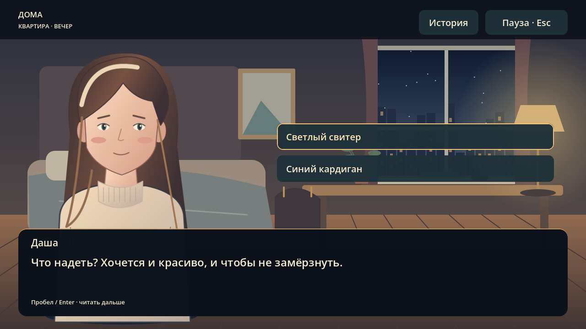
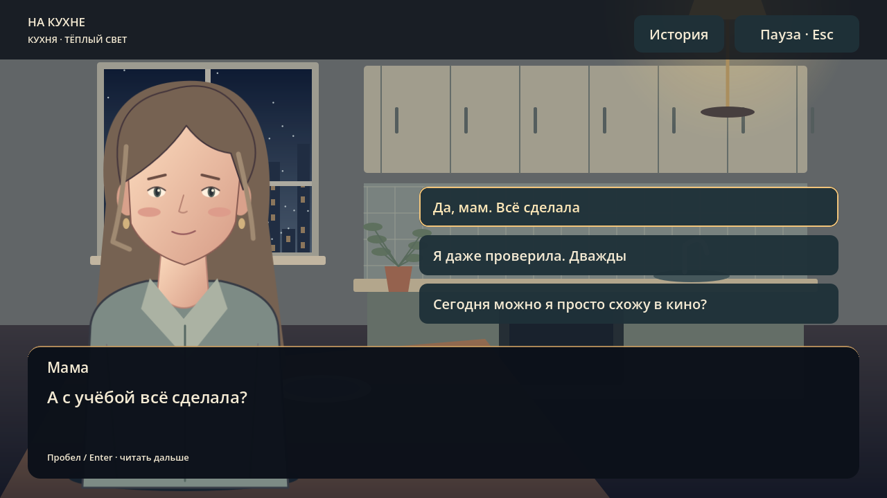
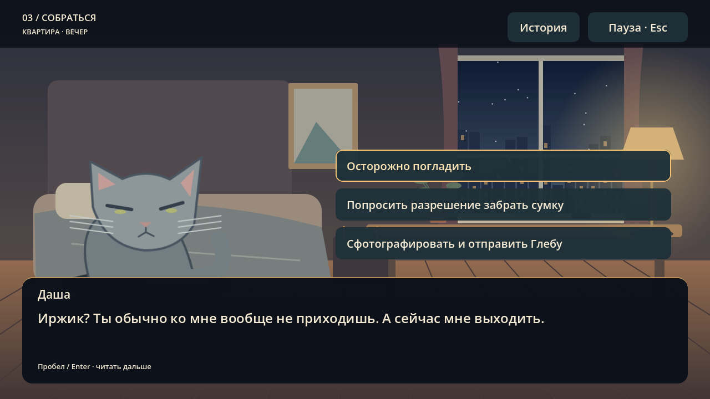
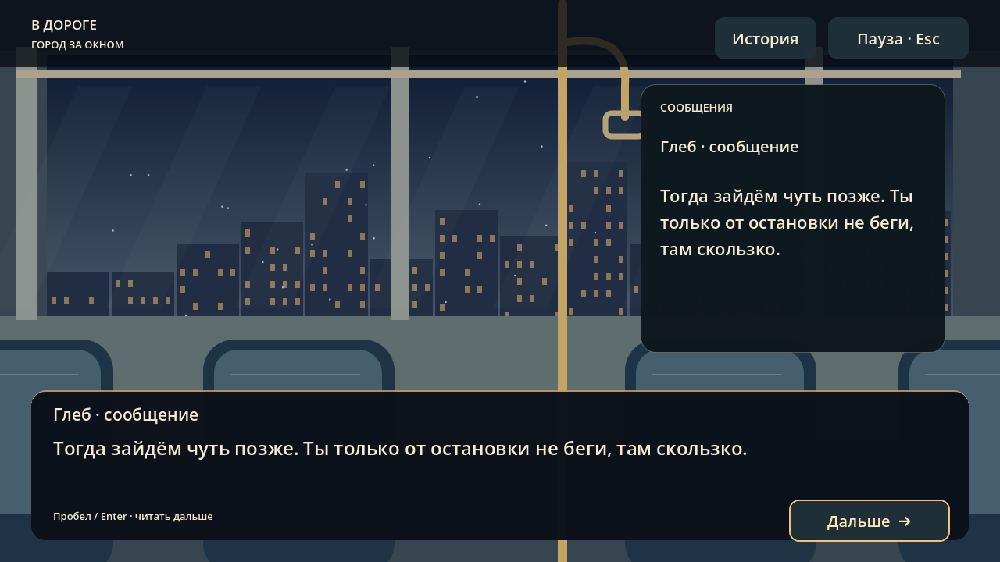
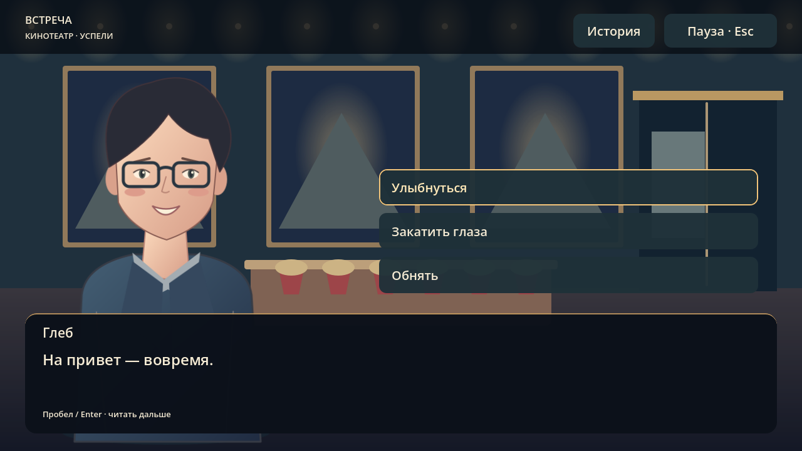

# Последний сеанс декабря — четвёртая, финальная глава

Запуск: открыть `scenes/levels/last_december.tscn` и нажать F6. В обычном прохождении глава открывается после Веневитино. Вся игра теперь состоит из четырёх глав; прежние зарезервированные «Корпорат» и «День рождения» заменены одной новеллой. Финал LOVE открывается после завершения всех четырёх глав. Для отдельного просмотра финала — `scenes/thread_map/finale_preview.tscn`.

## Что работает

- 109 авторских эпизодов и переходов: комната, кухня, Иржик, проверка сумки, короткие шуточные карточки, остановка, автобус, встреча, попкорн, кинозал.
- Два наряда Даши сохраняются до встречи; Глеб замечает выбранный наряд. Фото Иржика возвращается шуткой об охране. Выход заранее действительно меняет монолог в автобусе. Перекус, ответы маме, переписка и попкорн имеют свои реплики.
- Даша, Глеб, мама и Иржик представлены новыми векторными иллюстрациями. Для людей есть спокойное, радостное и тревожное выражения. Образ мамы условный: её фотографию автор пока не предоставлял.
- Музыка, сигналы сообщений и действий, плавная смена фонов, постепенное появление текста, журнал разговора.
- Сохранение текущей реплики, ответов и частично собранной сумки. Одежда и ветки переживают выход на карту и перезапуск. Повторный вход в завершённую главу начинает новый просмотр, сохраняя общее завершение игры.
- Пауза останавливает текст, галерею, видео и его звук. Пропуск фильма требует отдельного выбора. Возврат посреди фильма начинает фильм заново, а не пропускает его.
- Клубок заканчивает E, проходит по сохранённой кривой подчёркивания, камера открывает LOVE. Затем: «Даша, спасибо тебе за этот год. Я люблю тебя», «Продолжение — вместе», «А теперь посмотри на меня». Экран ждёт нажатия; автоматического выхода в меню нет.

Управление: мышь; Tab/Shift+Tab для выбора кнопки; Enter/Пробел для её нажатия. Первое нажатие раскрывает реплику, следующее продолжает. «История» открывает журнал, Esc закрывает его; в остальных случаях Esc открывает паузу. Выборы не оцениваются баллами и не создают плохой концовки.

## Что ещё нужно от автора подарка

**Личная нарезка года пока не предоставлена.** В рабочем финале используется короткая галерея чистых кадров трёх игровых локаций с музыкой. Это игровые воспоминания, не настоящие фотографии или записи года. Она позволяет пройти всю цепочку до LOVE уже сейчас.

Настоящее видео подключается без правки логики:

1. Подготовить ролик 16:9 в Ogg Theora (`.ogv`, звук Vorbis). Godot Compatibility поддерживает его штатно. MP4 не назначать напрямую.
2. Положить ролик внутрь `godot/assets/last_december/`, например `our_year.ogv`.
3. В Godot открыть `resources/last_december/film.tres` и назначить ролик в поле **Video**. Поле пока пустое, поэтому показывается галерея.
4. Запустить главу или в редакторе временно назначить контрольную реплику для проверки. В готовом прохождении фильм начинается после разговора в зале. Проверить громкость, начало, окончание, Esc и отмену пропуска. При наличии Video галерея и фоновая музыка автоматически отключаются; играет звук самого ролика.

Пример конвертации (из корня репозитория):

```bash
ffmpeg -i your_video.mp4 -vf 'scale=1280:720:force_original_aspect_ratio=decrease,pad=1280:720:(ow-iw)/2:(oh-ih)/2,setsar=1' -c:v libtheora -q:v 7 -c:a libvorbis -q:a 5 godot/assets/last_december/our_year.ogv
```

Для подарка остаётся выбрать личную нарезку и при желании уточнить настоящие реплики/интерьер. Сценарий — художественная версия предложенного вечера, а не утверждение, что такой разговор действительно происходил. «Одно видео» сейчас — две собственные шуточные иллюстрированные карточки, без подключения TikTok или чужих роликов.

## Редактирование

- Главная нативная сцена — `scenes/levels/last_december.tscn`; фоны — отдельные сцены в `scenes/last_december/`. UI, места кнопок, киноплеер, галерея, журнал и затемнения находятся в `.tscn`.
- Сценарий — `resources/last_december/story.tres`, ресурс `DecemberStory`; экспортируется как зависимость сцены. `art/last_december/author_story.py` сохраняет исходный сценарий с короткими функциями для редактирования веток.
- Арт — `assets/last_december/*.svg`, исходник `art/last_december/author_art.py`. Иллюстрации масштабируются без пиксельных краёв.
- `author_scenes.py` — необязательная офлайн-сборка исходных `.tscn`; при обычном запуске не выполняется. После ручного редактирования сцен не запускать его поверх своих правок.
- `author_finale.py` — выполненная однократная миграция карты, защищена от повторного применения. Дальше редактировать карту в Godot.
- `scripts/last_december/novel.gd` отвечает только за поведение. Ни уровень, ни интерфейс, ни персонажи не создаются кодом во время игры.
- Прогресс хранится в прежнем `journey_v1.cfg`, новый раздел данных — `journey/novel`, версия карты `map/route_schema = 2`. Завершение первых трёх глав и их сохранения остаются на месте. Старые недоступные позиции 4/5 не считаются прохождением новеллы.

## Проверки

`tests/december_smoke.gd`: три варианта прохождения, все адреса переходов, фактический ввод Enter/Esc, наряды, ответные шутки, сбор сумки, запись/загрузка, пауза/отмена пропуска, естественное окончание галереи и переход к карте, миграция старого сохранения.

`tests/thread_map_smoke.gd`, `tests/journey_smoke.gd`, `tests/gift_review_smoke.gd`: общая навигация, блокировка финала, четыре главы, подчёркивание, сохранения и регрессии предыдущих уровней. Отдельно проверено воспроизведение короткого тестового Theora-ролика, остановка при паузе и переход по сигналу завершения.

Визуальная проверка выполнена в настоящем Godot Compatibility через программный OpenGL; она не является замером FPS на ноутбуке игрока.







Финальный скриншот со спойлером: [LOVE](december-love.png).
