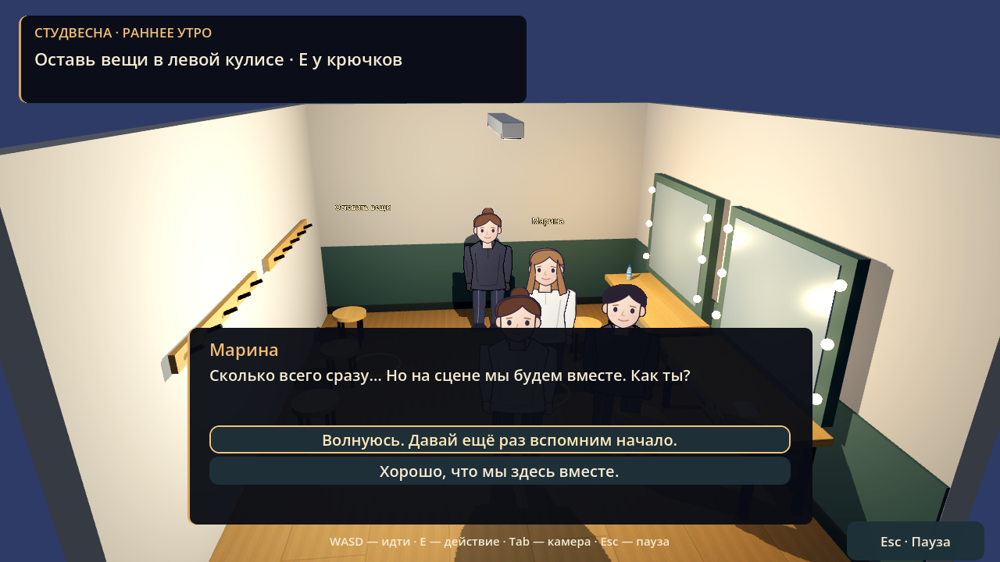
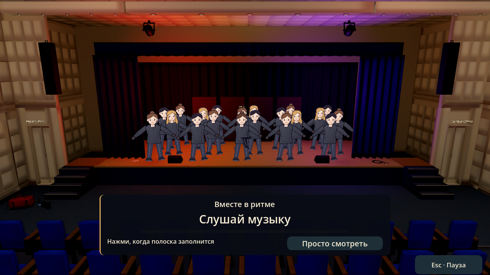
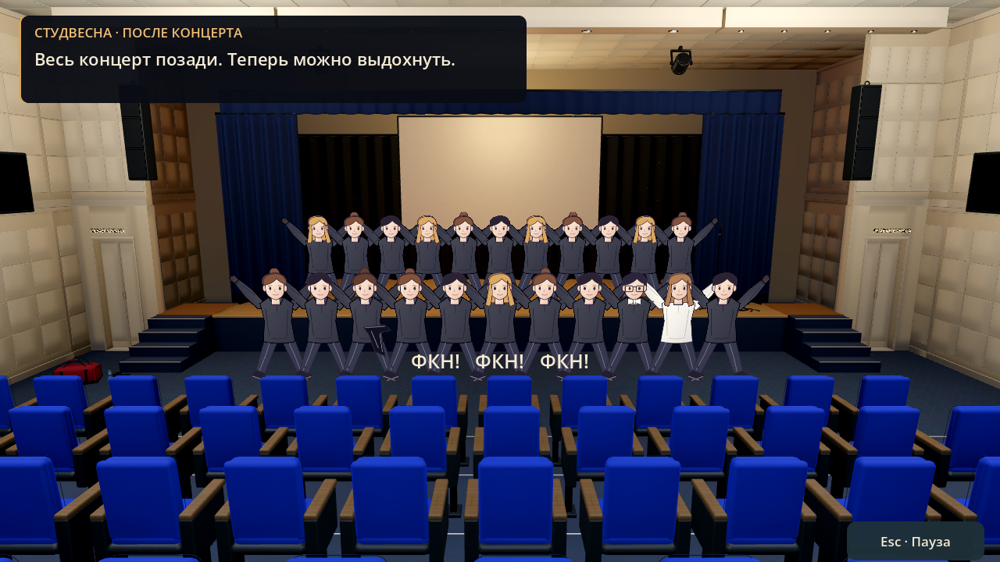
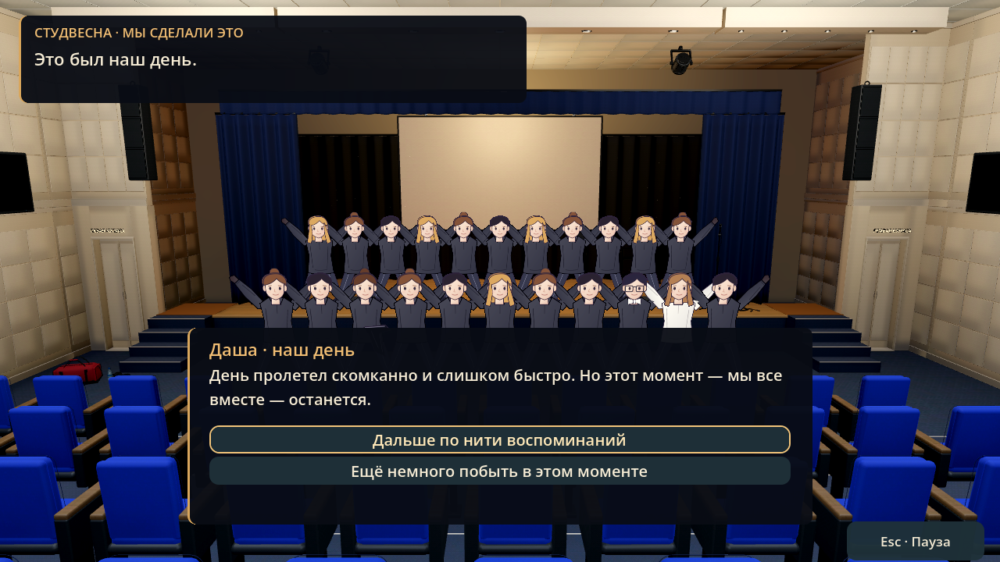

# Студвесна · первый игровой день

В `scenes/levels/auditorium.tscn` реализована цепочка: вещи → репетиция → костюм и грим → массовый танец → общий финал «ФКН!» → карта с клубком. Окружение, персонажи, точки взаимодействия, интерфейс, свет и анимационные дорожки сохранены в `.tscn`. Скрипты не создают геометрию, NPC или UI при запуске.

## Запуск и прохождение

Открыть `godot/project.godot` в Godot 4.6, F5 → «Начать игру» → первая остановка клубка. Для отдельной проверки открыть `scenes/levels/auditorium.tscn` и нажать F6. F6 использует текущий прогресс; новую историю начинают через меню с подтверждением.

- **WASD / стрелки** — идти, **Shift** — быстрее, **Tab** — обзор / первое лицо, **E** — действие, **Esc** — пауза. В диалоге выбор мышью или клавиатурой.
- Войти в левую кулису через отмеченный проход, положить вещи у крючков.
- Вернуться и подняться по боковым ступеням. Между шторой и напольным монитором оставлен проход. Пройти три золотые отметки на сцене, на каждой нажать E. Во время короткой выдержки меняется свет.
- В левой кулисе подготовить костюм у крючков и грим у зеркала, в любом порядке. У Даши появляется чёрный платок на бедре. Оба действия необходимы.
- Марина находится в левой кулисе, Глеб занят в правой. Разговоры необязательны; ответы не ухудшают отношения и не блокируют номер. Реплики написаны для игры, это не документальные цитаты.
- У левого края сцены подтвердить выход. Выбрать ритм или просмотр; режим можно переключать во время номера.
- В ритме нажать **A / ←** или **D / →** при заполнении полоски. Окно ±0,42 секунды, без проигрыша, негативной оценки и повторного начала из-за ошибок.
- После номера отдельный переход «После концерта», общая сцена, «ФКН!» и завершение. Можно оставить общий кадр на экране или вернуться к клубку.

## Персонажи и постановка

Шесть оригинальных векторных наборов: Даша, Глеб, Марина и три варианта участников. Составные рисованные персонажи стоят в 3D-сцене и поворачиваются к камере. Руки, ноги и корпус анимируются сохранёнными дорожками `AnimationPlayer`: idle, walk, dance, cheer. Это стилизованные фигурки, а не фотореалистичные портреты или скелетные 3D-модели.

Даша узнаётся по гульке и чёрному платку; во время номера над ней небольшая подпись. Глеб — короткие тёмные волосы, очки, белая бабочка, тёмный костюм; Марина — длинные светло-каштановые волосы и светлый верх по предоставленной фотографии. Её точный концертный костюм неизвестен.

В выступлении ровно 20 актёров, включая Дашу. На репетиции — 19 фоновых участников и управляемая Даша. В финале присутствуют Глеб и Марина. Все 80–90 участников концерта не симулируются по отдельности.

Хореография — игровая адаптация: несколько сохранённых перестроений, движения рисованных фигурок, красно-фиолетовый свет. Она не копирует покадрово реальный танец. Место Даши выбрано для читаемости; конкретная участница видео не была достоверно опознана. Настройка движения отключает перемещение камеры номера.

## Звук и ритм

- `assets/studvesna/audio/dance.ogg` — аудио из пользовательского `tanec_vesna.MP4`, около 131,74 секунды. MP4 остаётся без изменений в корне репозитория и не нужен для запуска игры.
- `resources/studvesna/rhythm.json` — 36 редких подсказок по положительным спектральным всплескам аудиодорожки. Это измеренные акустические акценты, не случайные ноты и не ручная музыкальная транскрипция; направления чередуются.
- Музыка запускается после первого отрисованного кадра сцены номера: подготовка шейдеров не съедает начало выступления. Камера и перестроения следуют аудиочасам с поправкой на задержку вывода. Пауза останавливает звук вместе со сценой.
- Шаги, ткань и отклики действий используют существующие оригинальные звуки проекта.
- `applause.wav` — оригинальные синтезированные хлопки. «ФКН!» показано текстом; настоящей записи общего крика и озвучки диалогов нет.

## Сохранения

Состояние хранится в `journey/hall` существующего `user://journey_v1.cfg`: этап, отметки репетиции, костюм, грим, разговоры, режим просмотра. Используются общие атомарная запись, `.bak` и `run_id`. Новый запуск очищает первый уровень вместе с остальной историей. Некорректные поля не позволяют пропустить обязательную подготовку.

При возвращении восстанавливаются задания, игрок появляется в зале. Прерванный танец возвращает к подтверждению выхода; подготовку повторять не нужно. Прерванный финал возвращает к общей сцене. Только `Stage.DONE` открывает следующую главу. Временной кнопки завершения прогулки больше нет.

Ошибка записи показывается сообщением. Выход через меню и переход на карту отменяются, если прогресс не удалось записать. При просмотре общего кадра остаётся доступна кнопка возврата к нити.

## Файлы и проверка

- `scenes/studvesna/story.tscn` — точки, собеседники, финальная группа, звук и интерфейс.
- `scenes/studvesna/performance.tscn` — 20 участников, декорации, свет, камера, дорожки перестроений.
- `scenes/studvesna/{dasha,marina,gleb,ensemble_a,ensemble_b,ensemble_c}.tscn` — персонажи и анимации.
- `scripts/studvesna/{story,actor}.gd` — поведение.
- `art/studvesna/` — инструменты предварительного авторинга; не запускаются игрой. `author_audio.py` ожидает моно PCM16 22050 Гц в `/tmp/studvesna-analysis.wav`, извлечённый из исходного MP4. Python/Scipy нужны только для повторного авторинга.

```sh
godot --headless --path godot --editor --import
godot --headless --path godot --quit-after 2
XDG_DATA_HOME=/tmp/studvesna-check/data XDG_CONFIG_HOME=/tmp/studvesna-check/config godot --headless --path godot --fixed-fps 60 --script res://tests/studvesna_smoke.gd
XDG_DATA_HOME=/tmp/journey-smoke-studvesna/data XDG_CONFIG_HOME=/tmp/journey-smoke-studvesna/config godot --headless --path godot --fixed-fps 60 --script res://tests/journey_smoke.gd
```

Проверки включают настоящие нажатия E, ходьбу по коллизиям к заданиям, проход на сцену, подготовку, диалоги, ритм, паузу аудио, просмотр, общий финал, восстановление и защиту завершения. Дополнительно проверяются прежние кулисы и карта. Скриншоты — из работающего Godot, с остановленной постановкой для выбора кадра.

Проверено: импорт и запуск Godot 4.6.3; 60 проверок Студвесны, 74 проверки путешествия между уровнями, 25 проверок кулис и 26 проверок карты — всего 185 успешных проверок. Отдельно проверена компоновка трёх вариантов ответа: кнопки не перекрывают друг друга и помещаются в карточку.

## Кадры из игры








